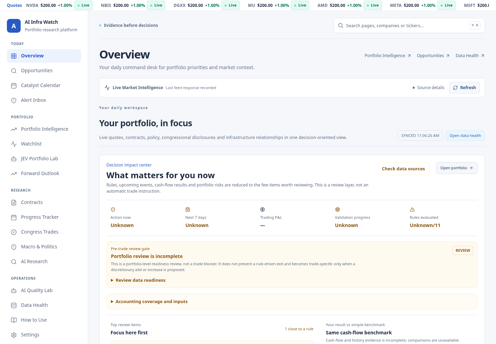
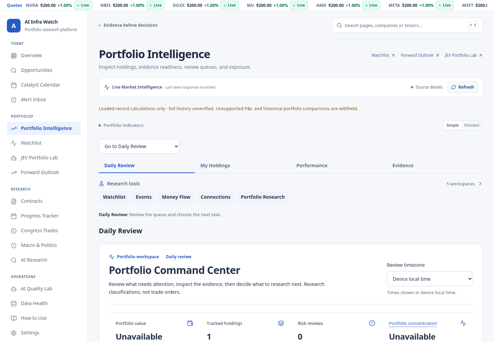
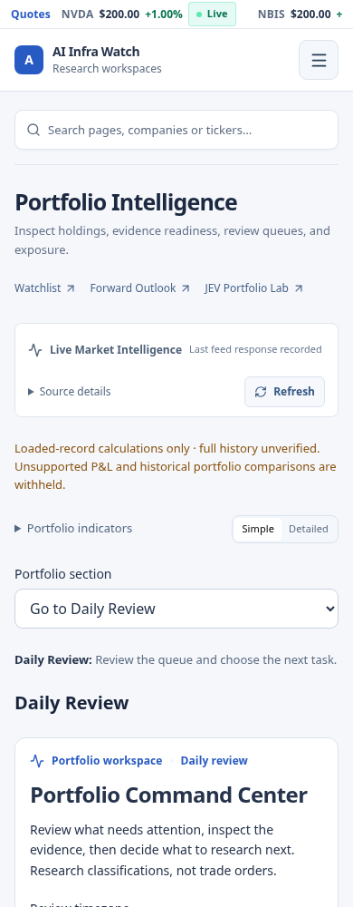

# Clean light workspace redesign

Date: 21 November 2026. Branch: `feature/light-workspace-redesign`.

The owner chose a clean light workspace with fewer cards and clearer navigation. This independent draft starts from shipped main `529e956254bc73c12ed8d7f4ffa6510f9b3d4442`. It does not incorporate or overwrite draft PR #185's separate quote-diagnostic work.

## Result

- All 17 existing destinations share a light canvas, white surfaces, navy text, blue active states, readable legacy labels, consistent tables, inputs and charts, and quieter grouped navigation.
- Workspace titles and related destinations replace large gradient headers, repeated badges and navigation counts. Search, mobile navigation, active-route semantics, browser history and existing deep links remain available.
- Portfolio uses flat primary section tabs, compact research links, expandable portfolio indicators and a separated summary row. Simple/Detailed controls remain directly available. Duplicate visible Portfolio heading copy is removed; the accessible page heading remains.
- Feed source metadata, the ecosystem learning guide and detailed readiness checks expand on demand. The current feed status, refresh control, failures and incomplete portfolio-readiness warning remain visible.
- Search, sign-in and the portalled native holding dialog use light surfaces. Focus rings, financial status colors and tabular numbers remain distinct. The mobile header no longer overlaps the search context; shorter related links and reduced mobile chrome bring the review content into view sooner.
- PWA browser chrome and install background use the light canvas.

## Rendered previews

These are actual Chromium renders at desktop 1440px and mobile 390px, using **fictional offline fixtures**. They are not live portfolio data or a production deployment.

## Verification

- TypeScript lint: passed.
- Node unit tests: 1,085 passed; financial and API implementations are unchanged.
- Focused mocked Chromium suite: 57 passed across shared navigation, Portfolio/history/modal, decision accounting and glossary.
- Final header-overlap correction: 10/10 application workspace tests passed, including all 17 routes at 390px and 1440px, light-canvas/title contrast, zero browser exceptions, zero overflow, zero passive API writes and keyboard-operated disclosures.
- Offline CI/deployment safety tests: 32 passed. The existing UI workflow now includes `qa/test_application_workspace.py`; no release workflow or deployment gate is changed.
- Security audit, production build and staged diff whitespace check: passed. Exact-head GitHub workflow results are authoritative in the draft PR checks; local results are not a substitute for CI.

React review: no added effects, fetching, dependencies, calculations or state duplication. Existing accessible names and route controls are retained; native disclosures use keyboard-accessible summaries; portal theme and focus visibility are explicit.

## Scope and limitations

This is the app-wide visual foundation plus focused Overview and Portfolio simplification. Specialized research, lab, forecast and editor workflows retain their existing feature behavior and information architecture. The fixtures verify rendering and interactions, not real provider availability or complete financial records. Missing-data states remain truthful. Dedicated chart series retain their existing distinguishing colors.

No merge, production deployment, production database modification, new live polling or Telegram send is part of this draft. Review the rendered design and exact-head CI before proposing a separate release. The PR #180 one-release control exception does not authorize this branch.
