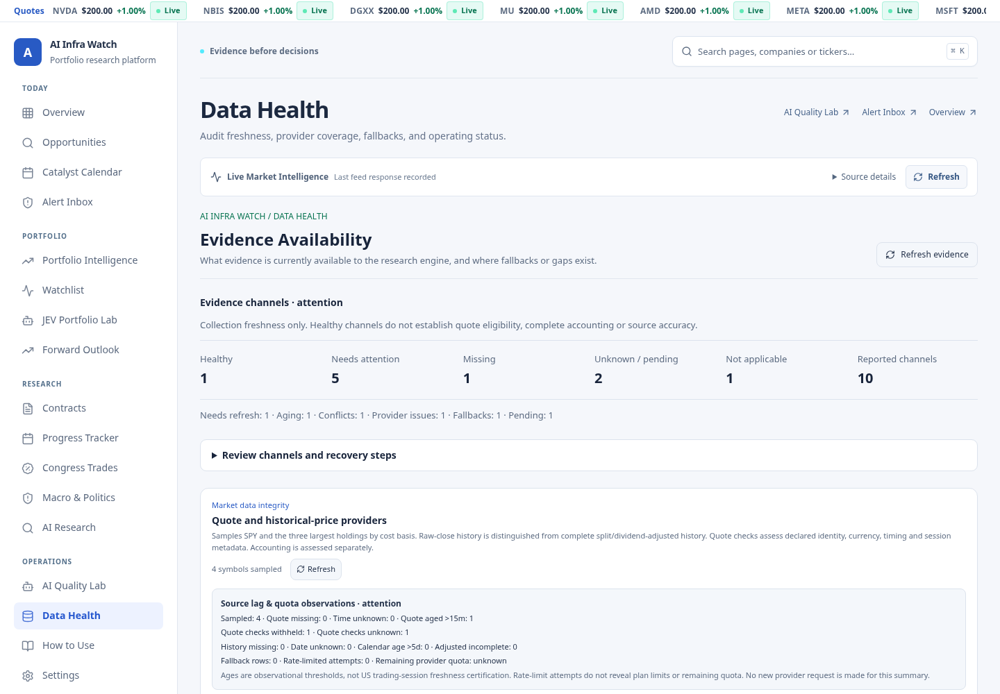
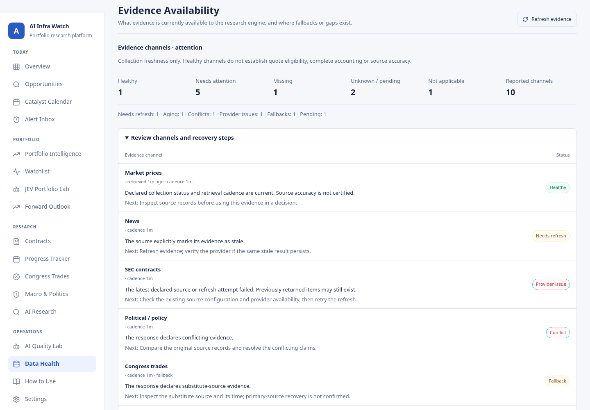
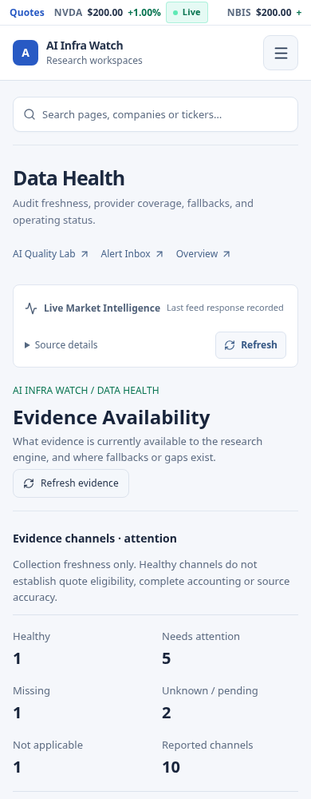

# Evidence channel health and recovery context

21 November 2026 · `feature/data-health-evidence-states` · [Draft PR #187](https://github.com/Blitzer0007/ai-infra-watch/pull/187)

## Problem and result

Data Health displayed “Needs refresh” in stale rows while its summary still counted the obsolete label “STALE”, producing a false zero. The old fallback path could call failed, unknown or inapplicable channels healthy merely because they carried a recent retrieval timestamp. Freshly retrieved data with source freshness explicitly marked STALE was also missed.

One deterministic classifier now drives both the summary and channel rows. It separates healthy collection, aging, stale, conflict, provider failure, fallback, missing, pending, not applicable and unknown metadata. Missing evidence is not a clean event day. Inapplicable channels are excluded from applicable health. A failed latest feed request unconfirms previous records; a successful explicit refresh can recover the display.

The compact summary partitions every reported channel into Healthy, Needs attention, Missing, Unknown / pending or Not applicable. These totals are mutually exclusive. Needs attention includes aging, stale, conflict, provider failure and fallback; its breakdown uses the semantic state, never the display label. Conflicts and failures take priority over lower-severity freshness observations. The rows explain each state and suggest a bounded next step behind a keyboard-accessible disclosure. Raw channel error messages and unrecognized status strings are not displayed.

Healthy describes declared collection status and retrieval cadence only. It never establishes source accuracy, admitted prices, complete accounting or investment validity. Retrieval timestamps require a timezone and valid parsing; clocks more than two minutes ahead, unsupported status, missing/nonpositive/nonnumeric cadence and incomplete source freshness remain unknown. Delivery age beyond two/five declared refresh intervals yields aging/stale respectively.

## Integration boundaries

This draft is stacked on the clean-light UI branch from [PR #186](https://github.com/Blitzer0007/ai-infra-watch/pull/186), pinned at `fe8bde2916ebb4b746c717516155824a339b6d42`. It ports the eight implementation, test, fixture and acceptance files from [PR #185](https://github.com/Blitzer0007/ai-infra-watch/pull/185), pinned at `c9db228aa878f14ad9c7f00af0006d838fdb1d3d`; its historical continuation file is deliberately not copied. Both original PRs and worktrees remain unchanged.

The quote-health sample therefore uses the existing shared quote admission gate and shows WITHHELD, LAST CLOSE or unknown legacy checks. It still samples SPY and at most three holdings. Diagnostic quote projection excludes raw price and the admitted packet. This is not complete portfolio coverage. See [quote diagnostic acceptance](QUOTE-ADMISSION-DIAGNOSTICS.md).

No acquisition route, provider call, timer, credential, financial valuation gate, sender, schema or release guard is added. The sole CI configuration change adds the new offline browser test file to the existing mocked UI job. No live API polling, Telegram sends, database mutations, merges or deployments are authorized by this draft.

## Verification

- 1,096 Node tests passed, including quote admission, collection classification, strict timing, unknown/missing/error distinctions, privacy and summary partition invariants.
- 36 focused Chromium checks passed: 13 new evidence cases, 13 sampled quote/operational cases and 10 application-wide navigation/light-theme checks.
- The final focus-clipping adjustment also passed 14 browser checks, including the existing Data Health refresh journey.
- 32 offline CI/deployment safety tests, TypeScript and QA build passed.
- Production build, staged security scan and whitespace check passed. Record fresh exact-head Frontend CI, Security audit and UI API DB Validation in the draft PR; prior-commit success is not current proof.

The new tests exercise mixed states at 360/768/1440px, keyboard disclosure, empty/malformed packets, future timestamps, provider failures with old records, explicit retry recovery, bounded initial sample reads, zero browser exceptions/overflow and zero writes. Fixtures and screenshots contain fictional data only.

## Previews

## Still required for real data recovery

Authenticated read-only diagnostics are needed to identify the actual provider failures by symbol before changing vendor mappings or configuration. Do not invent issuer identity, session, currency, source time or accounting rows to make a green label appear. Complete broker history, fees, corporate actions and supported currency evidence remain separate prerequisites for authoritative returns. This draft explains and tests failure states; it does not certify live provider availability or repair missing production financial records.

Production remains at main `529e956254bc73c12ed8d7f4ffa6510f9b3d4442` / READY `dpl_8jCVHBD3ZrnZWsnc9AcdaAE91e1v` as last verified after PR #180. A future release needs separate approval and current release controls; the completed PR #180 exception is not reused.
